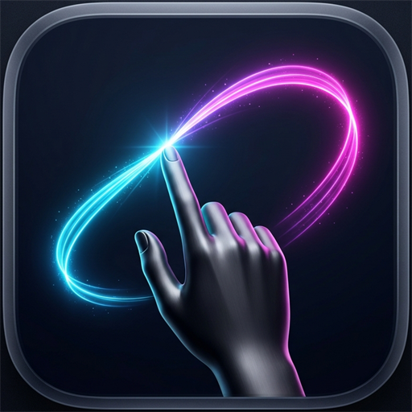

<div align="center">



# AirPresenter — Live Gesture AR Canvas & Whiteboard

**Pizarra aumentada en vivo sobre la webcam controlada por gestos manuales en el aire para videollamadas (Google Meet, Zoom, Teams), streaming (OBS) y grabaciones (Loom).**

[](https://developer.chrome.com/docs/extensions/mv3/)
[](https://pnpm.io/)
[](https://react.dev/)
[](https://www.typescriptlang.org/)
[](https://developers.google.com/mediapipe)
[](https://fabricjs.com/)

---

</div>

## 🌟 ¿Qué es AirPresenter?

**AirPresenter** transforma tu cámara web en una pizarra de presentación en realidad aumentada. Permite al orador o docente dibujar gráficos, resaltar ideas con punteros láser de neón y manipular formas **directamente en el aire con sus manos**, sin tocar el mouse ni el teclado durante la transmisión.

Diseñado tanto como **Extensión de Google Chrome (Manifest V3)** lista para la Chrome Web Store, como **Web App interactiva** lista para desplegarse en Netlify, Vercel o localmente.

---

## ✨ Características Principales

* 🖐🏻 **Tracking Gestual a 60 FPS**: Detección ultrarrápida impulsada por WebAssembly y MediaPipe Hands, ejecutada 100% en local sin enviar video a ningún servidor externo.
* 〰️ **Suavizado de Curvas (Midpoint Bézier)**: Elimina el temblor natural de la mano convirtiendo los puntos detectados en trazos fluidos de calidad vectorial.
* 🔴 **Láser de Neón Autodesvanecible**: Traza líneas fosforescentes que desaparecen suavemente tras 1.8 segundos, ideal para guiar la atención sin saturar la pantalla.
* ✏️ **Pincel Vectorial con Paleta de Colores**: Dibuja bocetos, flechas y esquemas con colores de alto contraste optimizados para fondos de cámara.
* 🤏🏻 **Agarrar y Mover (Pinch & Drag)**: Selecciona cualquier elemento previamente dibujado con el gesto de pinza y reubícalo en el espacio tridimensional de tu cámara.
* ✌🏻 **Borrador Gestual Instantáneo**: Levanta dos dedos (paz) y borra trazos al pasar sobre ellos en tiempo real.
* 👁️ **Modo Presentador Limpio (Tecla H)**: Oculta la interfaz con un clic o tecla para que la audiencia solo vea al presentador y sus gráficos flotantes.
* 📸 **Exportación en Alta Definición**: Captura la composición completa (webcam + anotaciones) en PNG con un solo clic para compartir pizarras al finalizar la videollamada.
* 🔒 **100% Offline & Seguro**: Los binarios `.wasm` y modelos `.tflite` residen dentro de la extensión; cumple estrictamente las políticas de Content Security Policy (CSP) de Google.

---

## 🖐🏻 Guía de Gestos Manuales

| Gesto | Icono | Acción en Vivo |
| :--- | :---: | :--- |
| **Solo Índice** | ☝🏻 | **Dibujar / Puntero Láser**: Traza en el aire según la herramienta activa. Al relajar la mano, el puntero se mueve sin pintar. |
| **Pinch (Pulgar + Índice)** | 🤏🏻 | **Agarrar y Mover**: Permite tomar y reposicionar anotaciones o figuras en el espacio. |
| **Dos Dedos (Paz)** | ✌🏻 | **Borrador Vectorial**: Borra cualquier trazo al pasar los dedos por encima. |
| **Palma Abierta (1s)** | 🖐🏻 | **Pausar / Reanudar**: Muestra un aro de carga HUD y alterna la lectura de gestos para evitar trazos accidentales. |
| **Doble Paz (Ambas manos)** | ✌🏻✌🏻 | Alterna el menú flotante de controles rápidos. |

---

## ⌨️ Atajos de Teclado

* **`H`**: Modo Limpio (oculta / muestra la barra de herramientas para la llamada).
* **`B`**: Activar Pincel libre.
* **`L`**: Activar Puntero Láser de desvanecimiento automático.
* **`V`** o **`M`**: Herramienta de Selección y Arrastre.
* **`E`**: Herramienta Borrador.
* **`Espacio`**: Pausar / Reanudar seguimiento gestual.
* **`Ctrl + Z`**: Deshacer última acción.
* **`Ctrl + Y`**: Rehacer acción.

---

## 🚀 Instalación y Desarrollo Local

Este proyecto utiliza estrictamente **`pnpm`** como gestor de paquetes.

```bash
# 1. Clonar el repositorio
git clone https://github.com/tu-usuario/airpresenter.git
cd airpresenter

# 2. Instalar dependencias
pnpm install

# 3. Iniciar servidor de desarrollo local
pnpm run dev
```

---

## 🧩 Cargar como Extensión en Google Chrome

1. Ejecuta la compilación de la extensión:
   ```bash
   pnpm run build
   ```
2. Abre Google Chrome y navega a:
   ```text
   chrome://extensions
   ```
3. Activa el interruptor **"Modo de desarrollador"** (esquina superior derecha).
4. Haz clic en **"Cargar descomprimida"** y selecciona la carpeta **`dist/`** del proyecto.
5. Haz clic en el ícono de **AirPresenter** en la barra de extensiones para abrir tu pizarra aumentada.

---

## 📦 Empaquetar para la Chrome Web Store

Para generar el archivo ZIP de distribución listo para subir al panel de desarrolladores de Google Chrome Web Store:

```bash
pnpm run package
```

Este comando compila el proyecto y genera automáticamente el paquete:
* **Archivo generado**: `AirPresenter-Extension.zip` (~13 MB con todos los modelos y WebAssembly incluidos).

---

## 🌐 Despliegue Web (Netlify / Vercel)

El proyecto es 100% estático una vez compilado:

* **Build command**: `pnpm run build`
* **Publish directory**: `dist`
* **Permisos**: Asegurarse de que el navegador tenga habilitado el acceso a la cámara mediante HTTPS.

---

## 🛠️ Stack Tecnológico

* **Framework & Core**: [React 18](https://react.dev/), [TypeScript](https://www.typescriptlang.org/), [Vite](https://vitejs.dev/)
* **Visión Artificial**: [Google MediaPipe Hands](https://developers.google.com/mediapipe) (WASM offline)
* **Motor Gráfico**: [Fabric.js](https://fabricjs.com/) (Canvas 2D vectorial acelerado)
* **Estilos**: [Tailwind CSS](https://tailwindcss.com/)
* **Gestión de Estado**: [Zustand](https://github.com/pmndrs/zustand)
* **Gestor de Paquetes**: [pnpm](https://pnpm.io/)

---

## 📄 Licencia

Distribuido bajo la Licencia MIT. Consulta el archivo `LICENSE` para más detalles.
